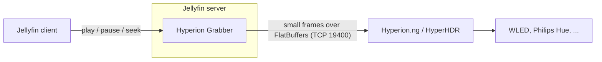

# Hyperion Grabber for Jellyfin

**Ambilight for everything you watch in Jellyfin, on any client.** The plugin streams the video that is playing to
[Hyperion.ng](https://github.com/hyperion-project/hyperion.ng) or [HyperHDR](https://github.com/awawa-dev/HyperHDR),
which drive your WLED strips, Philips Hue lights and every other LED device they support. No capture card, no app on
the TV.

!!! note "Early preview"
    Version 0.x streams library videos to Hyperion/HyperHDR while they play on the devices you select (one Hyperion
    server per TV), tone maps HDR10, HLG and Dolby Vision, plays an LED layout test pattern to set up your LEDs, and
    has a timing offset per device with a test video to calibrate it. See the [roadmap](roadmap.md) for what is next.

- **[Getting started](getting-started.md)**: install, connect and test in five minutes.
- **[Hyperion setup](user-guide/hyperion-setup.md)**: FlatBuffers server, LED layout (including LEDs that do not run around the TV), WLED and Hue.
- **[How it works](how-it-works.md)**: why no capture card or TV app is needed.
- **[Troubleshooting](user-guide/troubleshooting.md)**: wrong port, Docker networking, wrong colors.

## Why this plugin

| | HDMI capture / TV grabber | Hyperion Grabber for Jellyfin |
| --- | --- | --- |
| Extra hardware | Capture card, splitter | None |
| Clients | One TV or box | Any Jellyfin client (Kodi/LibreELEC, Android TV, webOS, Tizen, web) |
| HDR / DRM content | Often washed out or blocked | Decoded from the file; HDR10, HLG and Dolby Vision tone mapped to SDR |
| Latency | Always behind the picture | Frames are ready early; a timing offset (per device if needed) compensates the LED latency |
| LED layout | Hyperion | Hyperion (unchanged) |

## How it fits together

The plugin only produces the picture. Hyperion keeps doing what it is good at: mapping the picture to your LEDs,
color calibration, smoothing and driving the devices.
